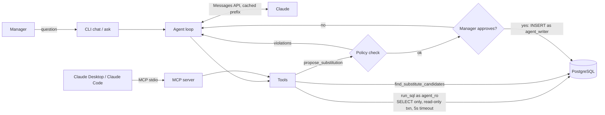

# Fulfillment Ops Agent

A Claude-powered operations assistant for a grocery store's online pickup department, built on the Claude API with a hand-written tool-use loop, an MCP server, least-privilege database access, human approval for every write, and an eval harness that measures accuracy, policy compliance, cost and latency.

Store managers ask questions in plain English ("which orders due in the next two hours still have out-of-stock items?") and Claude answers by writing and running SQL against PostgreSQL. When an item is out of stock, Claude finds candidates, applies the store's written substitution policy (dietary safety, price cap, size range, stock), and drafts the text message to the customer. A manager approves each proposal before anything is saved.

The idea comes from running a store's curbside pickup department: substitutions are the slowest, most error-prone part of the day, and one wrong substitution (dairy milk for a vegan customer) costs a customer's trust.

**See [DEMO.md](DEMO.md)** for a recorded session: Claude working through a manager's afternoon via the MCP server, including 11 policy-checked substitution proposals and a guardrail refusal.

> All data is synthetic and generated from a fixed seed: invented brands, invented customers, and phone numbers in the reserved 555-01xx range. No real store or customer data is used.

## What it shows

| Claude capability | Where |
|---|---|
| Tool use with a manual agent loop (parallel tool calls, `is_error` feedback, turn budget) | [`agent.py`](src/fulfillment_agent/agent.py) |
| Structured output: every run ends with a typed `final_answer` tool call (answer + the SQL behind it) | [`tools.py`](src/fulfillment_agent/tools.py) |
| Prompt caching: breakpoints on tools, system prompt and a moving breakpoint on the newest message | [`agent.py`](src/fulfillment_agent/agent.py) `build_request` |
| Model Context Protocol server (tools, resources, a prompt) usable from Claude Desktop or Claude Code | [`mcp_server.py`](src/fulfillment_agent/mcp_server.py) |
| Prompt engineering: XML-sectioned system prompt with live schema, policy and examples | [`prompts.py`](src/fulfillment_agent/prompts.py) |
| Human-in-the-loop approval for writes, with a code-level policy guardrail | [`tools.py`](src/fulfillment_agent/tools.py), [`policy.py`](src/fulfillment_agent/policy.py) |
| Evals: text-to-SQL execution accuracy, policy compliance, cost and latency, caching on vs. off | [`evaluation.py`](src/fulfillment_agent/evaluation.py), [`evals/`](evals/) |

## Architecture



**Safety is enforced by the database, not by the prompt.** Model-written SQL runs as `agent_ro`, a role with SELECT grants only and `default_transaction_read_only=on`; a text check rejects multiple statements and non-SELECTs early, and each query runs in a read-only transaction with a 5-second timeout and a 200-row cap. Writes go through `agent_writer`, which can insert substitution proposals and nothing else. The test suite checks that a writable CTE (`WITH d AS (DELETE ...) SELECT ...`), which passes the text check, is still stopped by the database.

**The policy is written once and used three ways:** stated in English in the system prompt, enforced in code inside `propose_substitution` (a non-compliant proposal is refused with reasons the model can read), and used by the eval to score Claude's first attempt *before* the guardrail. The candidate tool deliberately does not pre-filter by the policy, so the eval measures Claude's judgment rather than a filter's.

## Quick start

Requirements: Python 3.10+, Docker (or any PostgreSQL 14+), and an Anthropic API key.

```bash
git clone <your repo url> && cd fulfillment-ops-agent
python -m venv .venv && source .venv/bin/activate
pip install -e ".[dev]"
cp .env.example .env            # then put your ANTHROPIC_API_KEY in .env

docker compose up -d            # PostgreSQL 16 on localhost:5432
fulfillment-agent setup         # schema, roles, synthetic data (565 SKUs, 402 orders, 3,396 order lines)
pytest                          # 47 tests, no API key needed
```

Ask a question, or start a session (`-v` shows each tool call and the SQL):

```bash
fulfillment-agent ask -v "Which orders due in the next two hours still have items that need attention?"
fulfillment-agent chat -v
```

Example requests to try in `chat`:

- `How many orders are still to be picked today, by pickup hour?`
- `What's our substitution acceptance rate by category? Where are customers rejecting the most?`
- `Work through every out-of-stock item in orders due before 4pm and propose substitutes.` (you'll be asked to approve each one in the terminal)
- `Which vegan or gluten-free customers have orders waiting? Anything risky in them?`

The store clock is pinned to Monday 2026-10-12 13:30 (America/Chicago) so answers and evals are reproducible. `fulfillment-agent reset-proposals` removes proposals the agent saved.

## Use it from Claude Desktop or Claude Code (MCP)

The same tools are exposed over MCP, plus two resources (`fulfillment://schema`, `fulfillment://policy`) and a `substitution_sweep` prompt.

Claude Code:

```bash
claude mcp add fulfillment-ops -- /absolute/path/to/.venv/bin/fulfillment-agent mcp
```

Claude Desktop (`claude_desktop_config.json`):

```json
{
  "mcpServers": {
    "fulfillment-ops": {
      "command": "/absolute/path/to/fulfillment-ops-agent/.venv/bin/fulfillment-agent",
      "args": ["mcp"]
    }
  }
}
```

Over MCP the client's tool-permission prompt is the human approval step, and the policy guardrail still runs on every proposal.

## Evals

```bash
fulfillment-agent eval --limit 5                 # quick, cheap smoke run
fulfillment-agent eval                           # both suites, caching on
fulfillment-agent eval --compare-cache           # both suites twice: caching on, then off
fulfillment-agent eval --model claude-haiku-5-5  # compare models on identical cases
```

Results are printed and saved to `evals/results/` (a Markdown summary and a JSON file with every case).

**Text-to-SQL suite** ([`evals/sql_questions.jsonl`](evals/sql_questions.jsonl)): 40 questions (12 easy, 16 medium, 12 hard), each with a hand-written gold query, checked for ties so each has one right answer. Scored by execution accuracy: Claude's final query and the gold query are both run, and the result sets compared, ignoring row and column order and rounding numbers to 2 decimals. *Strict* needs identical columns; the headline number also accepts extra columns if every gold column is present. Includes trick questions whose right answer is zero.

**Substitution suite:** every order item that needs attention in today's open orders (56 items; 49 have a compliant substitute, 7 must not get one because the customer opted out or nothing complies). Claude handles each item in dry-run mode. Metrics:

- *correct action*: proposed when a compliant option exists, and did not when none does
- *first-attempt compliance*: Claude's first proposal passed every policy rule, before the guardrail
- *guardrail blocks*: proposals the code-level check refused
- *chose preferred*: picked the policy's tie-break winner (same product line, then closest size, same brand, lowest price, store brand)
- *message style*: customer text under 320 characters, signed, includes a price

Every run also records input, cache-write, cache-read and output tokens, cost (from the prices in [`pricing.py`](src/fulfillment_agent/pricing.py)), and median and p90 latency.

### Results

Run `fulfillment-agent eval --compare-cache` and paste the summary here. Template:

| | Sonnet 5.5, caching on | Sonnet 5.5, caching off |
|---|---|---|
| Text-to-SQL execution accuracy (40) | | |
| Substitution correct action (56) | | |
| First-attempt policy compliance | | |
| Cost per question | | |
| Median latency | | |

A full run of both suites costs a few dollars with Sonnet 5.5; run with `--limit 5` first to check your setup.

## Project layout

```
sql/schema.sql            tables, constraints, column comments (shown to Claude)
sql/roles.sql             agent_ro and agent_writer least-privilege roles
src/fulfillment_agent/
  data/generate.py        seeded synthetic catalog, inventory, customers, orders
  db.py                   setup, guarded read-only query runner, schema introspection
  policy.py               substitution rules: prompt text, guardrail, eval scorer
  tools.py                tool implementations and JSON schemas
  prompts.py              system prompt
  agent.py                tool-use loop with caching, approval and token accounting
  mcp_server.py           MCP server (stdio)
  evaluation.py           eval harness and report
  pricing.py              token prices and cost
  cli.py                  setup | ask | chat | eval | mcp | reset-proposals
evals/                    gold questions and saved results
tests/                    47 tests; the agent tests use a scripted fake client
```

## Limitations and next steps

- One store, one simulated day. A real deployment would read live order and inventory feeds.
- The SQL eval scores the final query's result, not the prose answer; a model-graded check of the answer text would add a second signal.
- Customer texts are drafted, never sent. Sending would go through an SMS provider after approval.
- Next: run the suites through the Message Batches API for cheaper large eval runs, and add a planner/executor split for multi-step sweeps.

## License

MIT
